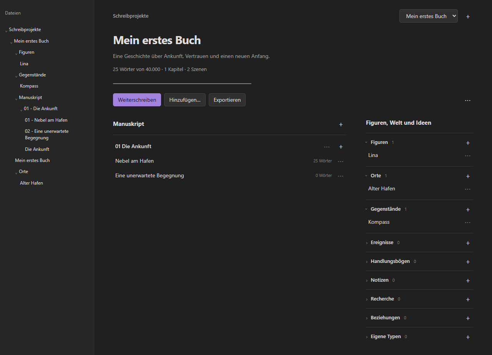
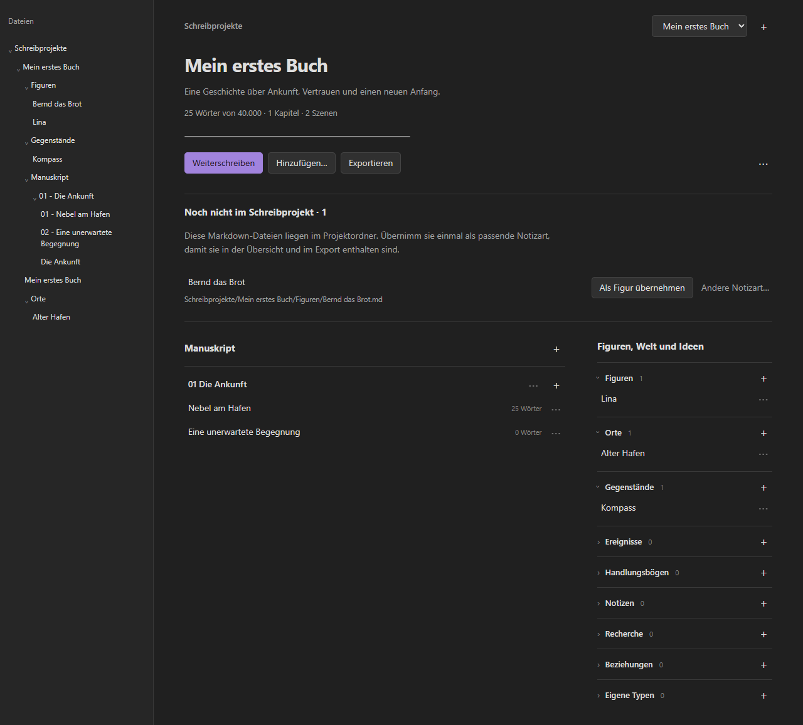
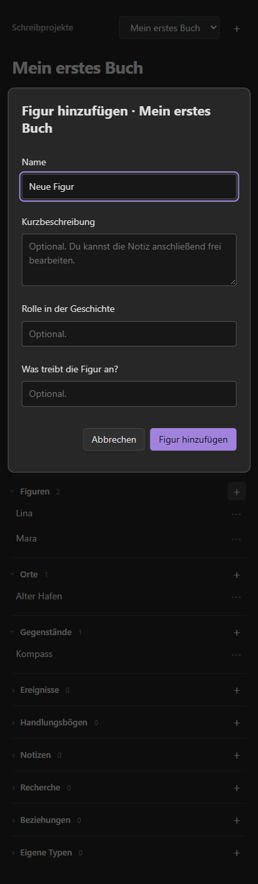
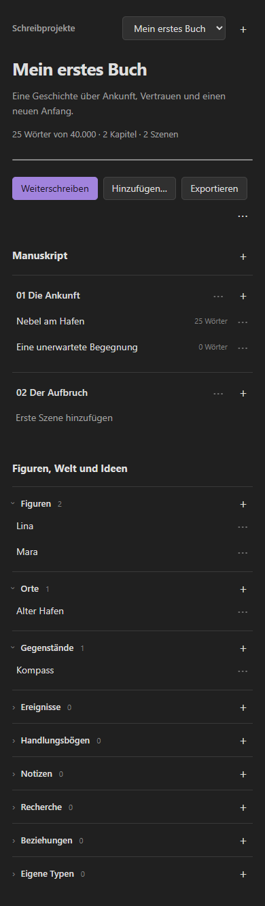
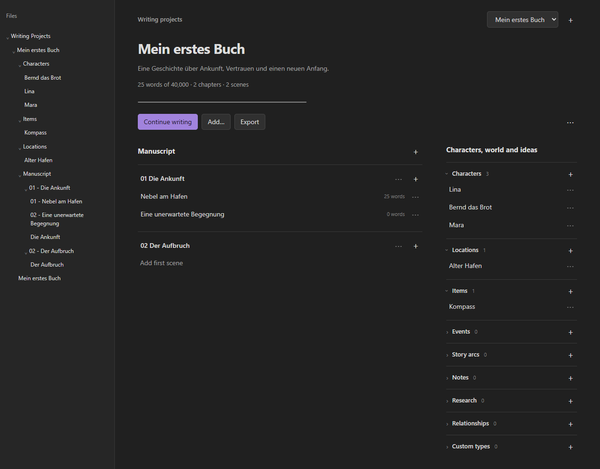

# Novel Planner - by Writeller

<p align="center"></p>

<p align="center"><a href="#deutsch">Deutsch</a> · <a href="#english">English</a> · <a href="https://www.writeller.com">writeller.com</a> · <a href="https://github.com/Cmdr-Hawkeye/writeller-obsidian/releases">Download</a></p>

<p align="center"><a href="https://github.com/Cmdr-Hawkeye/writeller-obsidian/actions/workflows/check.yml"></a> <a href="LICENSE">MIT-Lizenz</a> · Vorschau 0.3.1 · von Benni</p>

## Deutsch

Dein Buch wächst in **normalen Markdown-Dateien**. Writeller bringt Kapitel, Szenen, Figuren, Orte und Ideen in eine gemeinsame Schreibübersicht in [Obsidian](https://obsidian.md). Du schreibst in deinen eigenen Notizen und behältst eine lesbare Ablage.

**Kostenlos. Lokal. Ohne Konto.** Das Plugin benötigt keine Writeller-Lizenz und führt keine Netzwerk-, Tracking- oder KI-Aufrufe aus.



*Vorschau der tatsächlichen Oberflächenmodule im Browser-Testhost mit synthetischen Beispieldaten. Die Aufnahme ist kein nativer Obsidian- oder Geräteabnahmetest. [Herkunft der Bilder](docs/assets/README.md).*

## Vom ersten Kapitel zur Geschichte

- **Ein Schreibbereich:** Manuskript, Planung und Wortziel zusammen sehen.
- **Direkt hinzufügen:** Kapitel, Szene, Figur oder Ort wählen, verständliches Formular ausfüllen und losschreiben.
- **Lesbare Namen:** `Nebel am Hafen.md` statt einer Datei mit angehängten IDs.
- **Zusammengehöriges zusammen:** Kapitel und ihre Szenen liegen im selben Manuskriptordner.
- **Mehr als Manuskript:** Gegenstände, Ereignisse, Handlungsbögen, Recherche, Beziehungen und eigene Objektarten festhalten.
- **Bewusst austauschen:** Projektdateien mit Vorschau exportieren oder importieren und Konflikte selbst entscheiden.

## Installieren

Die folgende Anleitung beschreibt die manuelle Installation aus dem GitHub-Release. Die Oberfläche unterstützt Deutsch und Englisch. Voraussetzung: Obsidian **1.14.5 oder neuer**; echte Mobile-Geräte sind noch nicht abgenommen.

1. Den Vault sichern und das [Release 0.3.1](https://github.com/Cmdr-Hawkeye/writeller-obsidian/releases/tag/0.3.1) öffnen.
2. Unter **Assets** `writeller-0.3.1.zip` herunterladen und entpacken.
3. Den enthaltenen Ordner `writeller` nach `<Vault>/.obsidian/plugins/` kopieren. `main.js`, `manifest.json` und `styles.css` müssen direkt darin liegen.
4. Obsidian öffnen und **Einstellungen → Community-Erweiterungen → Novel Planner - by Writeller** aktivieren. Beim Update die Plugin-Dateien ersetzen und das Plugin neu laden.

Der Download ist das **Plugin-ZIP unter Assets**, nicht GitHubs automatisch erzeugtes Quellcode-Archiv. [Ausführliche Installations- und Updatehilfe](docs/faq.md).

## In drei Schritten anfangen

**Deutsch und Englisch:** Die Standardeinstellung **Automatisch (Obsidian)** wählt Deutsch bei deutscher Obsidian-Oberfläche und sonst Englisch. Unter **Sprache** kannst du das ändern. Strukturordner folgen nach bestätigter Vorschau der Sprache; `.md`-Dateinamen, Kapitel-/Projekttitel und eigene Ablagewurzeln bleiben erhalten. [Sprachen und Ordnerwechsel](docs/languages.md).

1. Das **Buchsymbol** anklicken oder **Novel Planner - by Writeller: Schreibprojekte öffnen** in der Befehlspalette wählen.
2. Ein **Schreibprojekt erstellen** und ihm einen Titel geben. Beschreibung und Wortziel sind optional.
3. **Kapitel hinzufügen**, darin eine **Szene hinzufügen** und in der geöffneten Markdown-Datei schreiben.

Figuren und Orte liegen rechts in der Übersicht. Ein Klick auf ihren Namen öffnet die entsprechende Notiz; das Menü daneben führt zu **Details bearbeiten**. Auch die Befehlspalette verwendet diese Schreibbegriffe.

## Notizen direkt in Obsidian anlegen

Auch **Neue Notiz** im Obsidian-Dateibaum ist möglich. Dateien im Projektordner erscheinen anschließend unter **Noch nicht im Schreibprojekt**. Unter `Figuren` schlägt das Plugin beispielsweise **Als Figur übernehmen** vor. Bestätige das Formular einmal; Text, eigene Properties und Dateipfad bleiben erhalten. Danach gehört die Notiz zum Projekt und wird exportiert. **Andere Notizart…** erlaubt eine abweichende Zuordnung.

Vor dem Export weist das Plugin auf noch nicht zugeordnete Dateien hin. Du kannst zuerst die Übersicht öffnen oder ausdrücklich nur die bereits zugeordneten Notizen exportieren. Im Rechtsklickmenü eines Projekt-Unterordners gibt es außerdem direkt **Novel Planner: Figur hinzufügen**, **Ort hinzufügen** usw.

<details>
<summary>Vorschau: normale Markdown-Notiz als Figur übernehmen</summary>



Aufnahme aus dem Browser-Testhost mit synthetischen Daten; keine native Geräteabnahme.

</details>

<details>
<summary>Figurenformular und schmale Ansicht ansehen</summary>

<p> </p>

Beide Aufnahmen stammen aus dem Browser-Testhost. Die schmale Ansicht belegt keine Ausführung auf einem Smartphone.

</details>

## Deine Dateien bleiben verständlich

```text
Schreibprojekte/
└─ Mein erstes Buch/
   ├─ Mein erstes Buch.md
   ├─ Manuskript/
   │  └─ 01 - Die Ankunft/
   │     ├─ Die Ankunft.md
   │     └─ 01 - Nebel am Hafen.md
   ├─ Figuren/Lina.md
   ├─ Orte/Alter Hafen.md
   └─ Notizen/Ideen zum Ende.md
```

Bei gleichnamigen Dateien wird nur bei Bedarf `(2)` ergänzt. Bisherige Projekte mit langen Hashnamen können über **Dateinamen vereinfachen** mit Vorschau neu geordnet werden.

Technische Begleitdaten und reine Exportordner werden beim Schreiben ausgeblendet. **Einstellungen → Writeller → Technische Informationen anzeigen** macht sie wieder sichtbar. Enthält ein Exportordner eigene Notizen, Bilder oder andere Dateien, bleibt er sichtbar. Die Dateien werden durch das Ausblenden nicht gelöscht. **Immer den vollständigen Vault einschließlich `Writeller-Daten` sichern.**

## Export und Writeller

**Exportieren** erstellt eine Datei wie `Exporte/Mein erstes Buch.writeller-exchange.json`. Vorher siehst du eine Vorschau; danach nennt eine Meldung den genauen Speicherort im aktuellen Vault. Bestehende Dateien werden nicht ersetzt. Importdateien kannst du in einen beliebigen Vault-Ordner kopieren und über **Projektdatei importieren** auswählen.

Der Austausch folgt dem offenen Vertrag **Writeller Exchange 1.0.0**. Der Vertrag ist in Writeller implementiert und getestet. So lassen sich Projekte manuell zwischen Writeller und diesem Obsidian-Plugin austauschen. Das frühere Archiv `*.writeller.json` ist ein anderes Format und bleibt inkompatibel. [Austausch und Grenzen](docs/compatibility.md).

Mehr über Writeller: **[www.writeller.com](https://www.writeller.com)**.

## Hilfe, Entwicklung und Lizenz

Zum Auffinden bestehender und verschobener Projekte ermittelt das Plugin Dateipfade im Vault und liest die Markdown-Dateien für die Identitätsprüfung. Auch nicht zugeordnete Notizen werden dabei lokal gelesen; sie werden nicht automatisch geändert. Exchange-Dateien und Projektbilder werden nach Auswahl beziehungsweise über geprüfte Projektzuordnungen gelesen. Dieser Zugriff ist für Projekttrennung, Wiederherstellung und vollständige Exporte erforderlich. Er erfolgt lokal über Obsidian; es werden keine Inhalte versendet.

Ab 0.2.4 werden Schema-Validatoren während des Builds erzeugt; das Plugin verwendet keine dynamische Codeausführung zur Laufzeit. Die drei installierbaren Release-Dateien werden in GitHub Actions gebaut und mit Herkunftsnachweisen versehen. Zusätzliche ZIP-, Lizenz- und Prüfsummendateien dienen der manuellen Installation; Obsidian selbst lädt nur `main.js`, `manifest.json` und `styles.css`.

| Gesucht | Hier geht es weiter |
| --- | --- |
| Bedienung und Details | [Handbuch](docs/handbuch.md) |
| Installation, Sprache, unsichtbare Ordner | [Häufige Fragen](docs/faq.md) |
| Änderungen | [Changelog](CHANGELOG.md) |
| Fehler oder Idee melden | [Issues](https://github.com/Cmdr-Hawkeye/writeller-obsidian/issues/new/choose) |
| Selbst beitragen | [CONTRIBUTING](CONTRIBUTING.md) |
| Architektur und Dateigrenzen | [Architektur](docs/architecture.md) |
| Performanceanalyse und Messvergleich | [Performance](docs/performance.md) |
| Tatsächliche Prüfungen und offene Geräteabnahme | [Prüfnachweis](docs/verification-report.md) |

Quellcode: **[MIT](LICENSE), © 2026 Benni**. Drittanbieter-Lizenzen: [THIRD-PARTY-NOTICES](THIRD-PARTY-NOTICES.md). Dieses Repository enthält den eigenständigen Obsidian-Adapter; keinen proprietären Writeller-Anwendungscode. Keine Zugehörigkeit zum Obsidian-Hersteller wird behauptet.

---

## English

**Chapters, scenes, characters and places. Your writing project in ordinary Markdown files.**

[Deutsch](#deutsch) · [English only](README.en.md) · [Download](https://github.com/Cmdr-Hawkeye/writeller-obsidian/releases) · [writeller.com](https://www.writeller.com)



*Screenshot of the production UI modules in a browser test host with synthetic project data and an explicit Obsidian API substitute. This is not a native Obsidian or mobile-device acceptance test. The interface supports English and German.*

## What you can do

- Create chapters and scenes, then write in real Markdown notes.
- Keep characters, locations, objects, events, story arcs, research and ideas together.
- Use readable filenames and chapter folders without appended identity hashes.
- Set a word target and see an approximate count of your scene text.
- Add relationships and your own catalog types.
- Import or export project files manually with a preview and explicit conflict decisions.

The plugin is free to use and requires no account or Writeller license. It makes no network, tracking or AI calls. Technical preservation data stays in your vault.

## Install the preview

The following steps describe manual installation from the GitHub release. Minimum version: **Obsidian 1.14.5**. Actual mobile-device acceptance tests are still pending.

1. Back up your vault and open [release 0.3.1](https://github.com/Cmdr-Hawkeye/writeller-obsidian/releases/tag/0.3.1).
2. Download `writeller-0.3.1.zip` from **Assets** and extract it.
3. Copy its `writeller` directory to `<vault>/.obsidian/plugins/`. `main.js`, `manifest.json` and `styles.css` must be directly inside that directory.
4. Enable Novel Planner - by Writeller in Obsidian's Community plugins settings. For updates, replace the plugin files and reload the plugin.

GitHub's automatic “Source code” archive is not the installable plugin ZIP.

## Start writing

Click the **book icon**, choose **Create writing project**, and enter a title. Use **Add chapter**, **Add Scene**, **Add Character** or **Add Location** to build your project. Titles in the overview open the actual Markdown notes.

```text
Writing Projects/My first book/
  My first book.md
  Manuscript/01 - Arrival/01 - Fog in the harbor.md
  Characters/Lina.md
  Locations/Old harbor.md
```

The interface and structural folders follow your language preference: **Automatic (Obsidian)** chooses German for German Obsidian installations and English otherwise. You can select **Deutsch** or **English** in the plugin settings. Folder changes show a preview; Markdown file names, user titles and project identities are preserved. Custom root names and hidden recovery-data paths remain stable. [Language and folder details](docs/languages.md). Obsidian's manifest description is one static bilingual field. [Manifest documentation](https://docs.obsidian.md/Reference/Manifest).

## Create notes directly in Obsidian

You can also use Obsidian's ordinary **New note** action. Markdown files inside a project folder appear under **Not yet in the writing project**. For example, a file in `Characters` offers **Adopt as Character**. Confirm the form once; existing text, user properties and the file path are preserved. The note then becomes part of the project and its exports. **Another note type…** lets you choose another type.

Before exporting, the plugin points out unassigned files so you can review them first or explicitly export only the already assigned notes. Folder context menus also offer direct typed creation, such as **Novel Planner: Add Character**.

## Where are exports and technical files?

Exports go to `Exports/<title>.writeller-exchange.json`. A twelve-second message shows the exact vault-relative path after a successful save. Existing files are never replaced. Import files can be placed in any ordinary vault folder.

The normal explorer view hides technical data and folders containing only exchange exports. Enable **Show technical information** in Novel Planner settings to reveal them. A folder containing ordinary notes, images or other files remains visible. **Back up the entire vault, including `Writeller-Daten`; hiding a folder does not remove its files.**

The adapter follows **Writeller Exchange 1.0.0**. The contract is implemented and tested in Writeller, enabling manual project exchange between Writeller and this Obsidian plugin. Legacy `*.writeller.json` archives use a different format and remain incompatible. See the [compatibility notes](docs/compatibility.md) and [verification report](docs/verification-report.md) for details.

## Help and contributing

To find existing or moved projects, the plugin inventories vault file paths and reads Markdown files to check their identity metadata. This includes local reads of unassigned notes; they are not changed automatically. Exchange files and project images are read after selection or through validated project mappings. These local Obsidian API operations support project separation, recovery and complete exports. No contents are transmitted.

Since 0.2.4, schema validators are generated at build time; the plugin does not dynamically execute generated code at runtime. GitHub Actions builds and attests the three installable release files. Additional ZIP, license and checksum files support manual installation; Obsidian downloads only `main.js`, `manifest.json` and `styles.css`.

[German handbook](docs/handbuch.md) · [FAQ](docs/faq.md) · [Changelog](CHANGELOG.md) · [Report an issue](https://github.com/Cmdr-Hawkeye/writeller-obsidian/issues/new/choose) · [Contributing](CONTRIBUTING.md)

Written in TypeScript; Node 22 is used for development. Run `npm ci`, then `npm run check`. The optional `npm run test:ui` uses an already installed Chromium browser or a path supplied through `UI_BROWSER`.

**[MIT license](LICENSE), © 2026 Benni.** [Third-party notices](THIRD-PARTY-NOTICES.md). No proprietary Writeller application code is included. This project is not affiliated with the Obsidian manufacturer.
